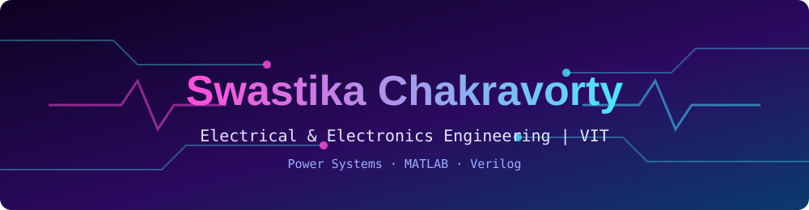

### 👩‍💻 About Me:

- 3rd-year B.Tech student in Electrical and Electronics Engineering at VIT
- I like power systems, and I build my lab simulations in MATLAB (bus impedance matrices, fault analysis, load flow)
- I have worked on data acquisition and control with LabVIEW, and on face tracking with audio beamforming in MATLAB
- Currently learning Verilog HDL for digital design
- Preparing for GATE 2027
- Open to collaborating on projects, feel free to reach out

### 🛠️ What I use:

 

### 🚀 Projects:

- [Automated Temperature DAQ & Control](https://github.com/SwastikaChakravorty/automated-temperature-daq-control) - LabVIEW
- [AV Zoom: Face Tracking & Audio Beamforming](https://github.com/SwastikaChakravorty/av-zoom-face-tracking-audio-beamforming) - MATLAB
